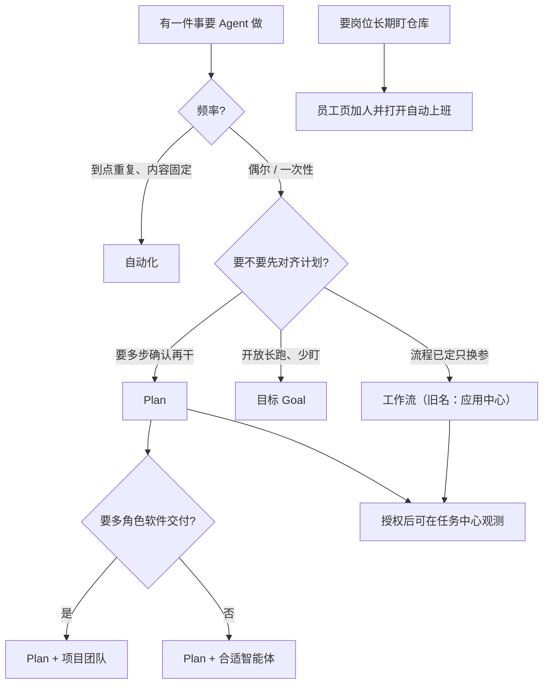

# 给谁用 · 解决什么 · 功能怎么串

> **先分清智能体和员工**
>
> 1. **区别**：智能体管「会什么」（人设、模型、工具、技能、连接器 MCP）。员工管「何时主动干」（岗位、职责、部门与上级、上班时间、转交审批、工作空间、绑定知识库、预算）。聊天里 @ 智能体不会自动值班。
> 2. **员工能配什么**：加人时填岗位名称、职责、部门、上级、知识库；更多设置里有能力来源、工作空间、工作模型、转交审批（全自动 / 平衡型 / 谨慎型）、自动上班。编辑岗位还可配工作方式、模型思考、系统提示词注入、知识库检索和预算。工具、技能、连接器到「智能体」页改。
> 3. **怎么操作**：侧栏「员工」→「加人」→ 填岗位和至少一条职责 →「确认加人」→ 打开自动上班，或点「现在开始工作」，急活用小V 派活。交工后到任务中心确认或打回。字段见 [智能体员工](../guides/configuration/smart-employees.md)。

> **比如你刚知道 EvoFlow，想搞清"这玩意儿到底能帮我干嘛？"**：
>
> - **写代码**：你让 AI"重构飞书渠道的消息格式化模块，拆文件、补单测、跑通过"——AI 自己拆步骤、写代码、跑测试
> - **盯服务器**：设个目标"每小时检查 gateway 和 langgraph 是否健康，异常就推飞书"——跑 7 天自动停，中间不用管
> - **定时出周报**：配个自动化，每周五下午 5 点自动汇总本周进展，推送到飞书
> - **飞书里干活**：在群里 @机器人 "帮我查一下今天 AI 圈有什么新闻"——AI 直接回复
>
> 读完本页你会搞清三个问题：**这个产品适合谁？我的问题该用哪条能力？几条能力怎么配合，而不是互相当成同一功能？**
>
> 和 Codex、WorkBuddy 怎么选，按你这周的活来看：[和 Codex、WorkBuddy 差在哪](../explanation/vs-codex-workbuddy.md)。

---

## 一、产品一句话

EvoFlow 是让 **Agent 把事做完** 的桌面/Web 产品：不只聊天，还能规划、授权执行、看板观测、定时值班、沉淀成可再跑的应用，并可接到飞书等 IM。

特别适合两类用法：
1. **个人固定业务** — 多节点工作流在工作流（旧名「应用中心」）产品化，填参再跑；  
2. **组织协作** — 多个 AI 员工并行，关键环节审批 / 验收。

适合：**多步、要结果、要可恢复** 的工作。  
不太适合：只想随口问一句就走的轻量问答（也能聊，但不是主战场）。

---

## 二、目标人群

| 人群 | 典型身份 | 核心痛点 | 优先用什么 |
|------|----------|----------|------------|
| **研发与构建者** | 独立开发者、全栈/后端、技术负责人 | 需求到可运行成果链路长；怕上下文丢、怕盯屏 | Plan、项目团队、工作区、Claude Code、任务中心 |
| **知识工作者** | 研究、分析、咨询、学生 | 检索—归纳—成稿易中断；怕幻觉堆砌 | 聊天 + 知识库/上传文档、记忆、技能、长任务 |
| **内容与运营** | 文案、运营、自媒体 | 环节多、工具杂、要反复出同类稿 | 工作流、自动化、技能、创意相关场景 |
| **业务与综合岗** | 运营、项目、行政 | 日报汇总、整理资料；习惯在 IM 办事 | 自动化、目标、飞书渠道、自然语言下指令 |
| **团队赋能者** | Founder、数字化接口人 | 要给同事开箱角色，又要可控可观测 | 智能体、预设角色、任务中心、智能体员工 |

**主战场**：个人与小团队（约 1～30 人），没有专职 AI 平台组，但需要长任务 + 多角色 + 桌面/IM。  
**暂不主打**：仅单次问答；要重度企业权限/审计的大型组织（需商用与专项集成）。

更细的人群表见 [项目介绍](introduction.md) [[introduction|项目介绍]]。

---

## 三、你想解决什么问题 → 用哪条能力

| 问题 / 诉求 | 用这个 | 不要误当成 |
|-------------|--------|------------|
| 跟 Agent 聊清楚、试想法、改文件 | **实时聊天**（Ask / Agent） | — |
| 多步任务要先对齐计划再动手 | **Plan 模式** | 目标 Agent、自动化 |
| 软件类多角色交付（规划/实现/验收） | **Plan + 项目团队** | 智能体员工（那是值班岗） |
| 记待办、小V 派给员工、看板看进度/验收、员工间协作 | **任务中心**（+ **小V**） | 聊天里的 Plan（Plan 是发起与主控对话）；勿与员工长期记忆共享混淆 |
| 开放长任务、后台多轮自驱到边界 | **目标 Agent**（聊天 Goal） | 任务中心、自动化 |
| 每天/每周到点跑提示词或已发布工作流 | **自动化**（提示词 Agent / 定时工作流） | 智能体员工主动值班、任务中心 |
| 流程已跑通，以后只换参数再跑 | **工作流（旧名「应用中心」）** | 每次从零 Plan |
| 岗位定时上班、审批、工作汇报写报告 | **智能体员工** | 自动化（无岗位合同/看板） |
| 记得用户偏好、过程与经验；员工各自沉淀岗位经验 | **资产中心**（用户记忆∥员工独立记忆；画像可共享） | 知识库、上传文档；勿当成员工间共享工作记忆 |
| 把 PDF / Office / Markdown 做成可反复检索的资料 | **知识库**（新建库 → 上传 → 问 AI / 检索） | 资产中心、会话里拖文件 |
| 当前这一轮附带几个文件 | **会话文件上传** | 知识库 |
| 给人设、工具、技能、连接器（MCP） | **智能体** | 员工（加人之后才按点上班） |
| 接 GitHub / 数据库等外部服务 | **智能体 → 连接器** | 在员工页安装插件 |
| 在飞书里对话、收结果 | **消息渠道** | — |
| 把现有业务网页/系统挂进面板统一打开，再接 AI | **Agent 应用** | 工作流（那是填参再跑的流程产品）；插件市场 |

---

## 四、功能地图（按侧栏心智）

```text
聊天壳
├── 新建对话 ── Ask / Agent / Plan / Goal（目标）；底栏可绑工作空间
├── 任务中心 ── 用户待办（我的事项）+ 协作任务；小V 派发；员工间/上下级协作；验收 / 同意派发
├── 工作流（旧名「应用中心」）── 多节点画布编排 → 发布 → ▶ 填参再跑（个人固定业务）
├── 自动化   ── 提示词 Agent 到点执行 ∥ 已发布工作流定时触发（`#/cron`）
├── 员工     ── 加人、值班、转交审批、工作汇报；小V 可临时委派
├── 智能体   ── 人设 / 技能 / 连接器（MCP 插件）
├── 资产中心 ── 画像 / 记忆 / 经验沉淀 / 反思过程 / 专长（`#/assets`）
├── 知识库   ── 自有文档库：上传、检索、问 AI（`#/knowledge`）
├── Agent应用 ── 统一列表承载业务网页/系统；平台内打开；可接工作流/员工/知识库（`#/extensions`）
└── 设置
    ├── 模型 · IM（含渠道多账号）· 通用（默认工作空间）
    ├── 安全中心 · 用户权限 · 企业 SSO（多账号体系）
    ├── 使用统计（费用）· 代码索引 · 资源中心 / 资源市场
    └── （运维观测面板另见 `#/observability`）
小V（全局 AI 小秘书）── 待办管理、任务派发、进度与结果反馈；一员工一会话委派、按需工作轨迹
```

| 能力 | 一句话 | 操作指南 |
|------|--------|----------|
| 实时聊天 | 主入口；模式决定怎么干 | [基础功能](../guides/chat/basic-functions.md) [[guides/chat/basic-functions|基础功能]] |
| Plan | 先定稿再「开始执行」 | [Plan 模式](../guides/chat/plan-mode.md) [[guides/chat/plan-mode|Plan 模式]] |
| 目标 | 聊天里长程自驱 | [目标 Agent](../guides/chat/goal-agent.md) [[guides/chat/goal-agent|目标 Agent]] |
| 工作空间 | 项目目录绑定与读写边界 | [工作空间](../guides/chat/workspace.md) [[guides/chat/workspace|工作空间]] |
| 任务中心 | 用户待办 + 员工协作派发 + 追踪交付；小V 协调 | [概念](../explanation/task-center.md) · [操作](../guides/tasks/task-center.md) |
| 小V | 全局 AI 小秘书：待办、派发、进度与结果反馈 | [任务中心概念](../explanation/task-center.md) · [EvoPanel 指南](../guides/configuration/evopanel-guide.md) |
| 工作流（旧名「应用中心」） | 多节点工作流产品化 | [工作流](../guides/configuration/app-center.md) [[guides/configuration/app-center|工作流]] |
| 自动化 | 提示词 Agent 自动化 ∥ 定时工作流；调度与执行历史 | [概念](../explanation/automation-center.md) · [操作](../guides/tasks/scheduled-tasks.md) |
| 智能体员工 | 编内值班岗 + 关键审批；可用小V 委派 | [指南](../guides/configuration/smart-employees.md) [[guides/configuration/smart-employees|指南]] · [教程](../tutorials/hire-first-smart-employee.md) [[tutorials/hire-first-smart-employee|教程]] · [概念](../explanation/smart-employees.md) [[explanation/smart-employees|概念]] |
| 智能体 | 能力包配置 | [智能体管理](../guides/configuration/agent-management.md) [[guides/configuration/agent-management|智能体管理]] |
| 资产中心 | 用户资产∥员工资产；画像可共享、记忆互不共享 | [概念](../explanation/asset-center.md) [[explanation/asset-center|资产中心概念]] · [操作](../guides/configuration/asset-center.md) [[guides/configuration/asset-center|资产中心]] |
| 知识库 | 上传文档后检索、问 AI，并可绑给员工 | [知识库](../guides/configuration/knowledge-base.md) |
| Agent 应用 | 多来源业务应用统一列表，平台内打开；可接工作流 / AI 员工 / 知识库 | [概念](../explanation/agent-applications.md) · [操作](../guides/configuration/settings-capabilities.md) |
| 设置治理套件 | 安全中心 · 费用 · 代码索引 · 资源市场 · 多用户/SSO | [设置](../guides/configuration/settings.md) [[guides/configuration/settings|设置]] · [资源市场](../guides/configuration/resource-packs.md) [[guides/configuration/resource-packs|资源包与资源市场]] · [生态对照](../explanation/ecosystem-comparison.md) [[explanation/ecosystem-comparison|生态对照]] |

面板入口总表：[EvoPanel 指南](../guides/configuration/evopanel-guide.md) [[guides/configuration/evopanel-guide|EvoPanel 指南]]。

---

## 五、功能之间怎么配合

### 5.1 决策：我该开哪条「做事」路径？



### 5.2 常见组合（怎么串）

| 组合 | 怎么用 |
|------|--------|
| **聊天 Plan → 任务中心** | 底部选 Plan → 定稿 →「开始执行」→ 右侧工作流；需要看板时打开任务中心「对话」 |
| **Plan → 另存为应用** | 确认条「另存为应用」或任务详情沉淀 → 以后填参再跑 |
| **加人 → 需要时再改智能体** | 员工页直接加人（自动创建能力）→ 要改工具或连接器时打开对应智能体勾选 → 再开一轮上班 |
| **小V → 待办 / 员工委派** | 对小V说记待办或直接派活 → 左侧选员工下目标；进度与结果可回任务中心核对 |
| **员工交工 → 任务中心** | 交工带任务总结；详情里「确认完成 / 要求修改」。转交用「同意派发 / 驳回」，别和验收混 |
| **知识库 → 员工或聊天** | 新建库并上传 → 库里先「问 AI」验证 → 加人时绑定该库，或在智能体上勾选 |
| **自动化 → IM** | 配好渠道 → 自动化开「完成后推送」→ 到点结果进飞书等 |
| **目标 → IM** | 聊天 Goal 跑完可推送小结（需渠道允许） |

### 5.3 三组最容易混的概念

| 组 | 区别一句话 |
|----|------------|
| **Plan vs 目标 vs 自动化 vs 任务中心** | Plan=先计划再授权；目标=聊天长跑；自动化=到点提示词或工作流（≠员工值班）；任务中心=待办+协作派发+看板（小V 协调） |
| **智能体 vs 员工** | 智能体=会什么（含连接器）；员工=何时主动干、职责、审批、绑定哪套知识库 |
| **资产中心 vs 知识库 vs 会话上传** | 资产=用户记忆/画像∥员工独立记忆与经验（画像可共享）；知识库=你上传的文档；会话上传=仅本轮附件 |

---

## 六、三条典型路径（按人群）

### 路径 A · 开发者：从需求到可运行小功能

1. 配模型 → 绑工作区  
2. 底部 **Plan**，用项目团队提示词（见 [项目级 Plan](../guides/chat/project-team-plan-workflow.md)）  
3. 「开始执行」→ 看右侧工作流 / 任务中心  
4. 跑通后可 **另存为应用** 供下次填参  

### 路径 B · 运营：每日汇总推飞书

1. 配模型 + 飞书渠道  
2. **自动化** 选提示词（并选执行员工/智能体）或已发布工作流，配每天时刻  
3. 点「运行」试一次 → 看历史 / 飞书是否收到  

### 路径 C · 小团队：岗位盯仓库

1. 侧栏「员工」点 **加人**，写清职责；更多设置里绑仓库工作区，转交审批先选「谨慎型」（教程 [加人](../tutorials/hire-first-smart-employee.md)）
2. 打开自动上班 → 处理待审批；交工后在任务中心看 **任务总结** 再验收  
3. 临时目标可用 **小V** 委派该员工，不必改职责
4. 大工程仍走 Plan / 任务中心，不要全塞给值班岗  

---

## 七、接下来读什么

| 目的 | 文档 |
|------|------|
| 安装与第一次对话 | [下载](downloads.md) [[downloads|下载]] · [快速上手](quick-start.md) [[quick-start|快速上手]] · [第一个任务](first-task.md) [[first-task|第一个任务]] |
| 功能怎么点 | [操作指南总目录](../guides/README.md) [[guides/README|操作指南总目录]] |
| 面板有哪些入口 | [EvoPanel 指南](../guides/configuration/evopanel-guide.md) [[guides/configuration/evopanel-guide|EvoPanel 指南]] |
| 产品定义与能力清单 | [项目介绍](introduction.md) [[introduction|项目介绍]] |
| 设计为什么这样 | [为什么是 EvoFlow](../explanation/why-evoflow.md) [[explanation/why-evoflow|为什么是 EvoFlow]] |
| 踩坑 | [FAQ](../guides/faq.md) [[guides/faq|FAQ]] |

---

## 相关阅读

- [[getting-started/introduction|项目介绍]] — 产品定义、能力清单与目标人群
- [[getting-started/quick-start|5 分钟快速上手]] — 从安装到第一次对话
- [[explanation/why-evoflow|为什么是 EvoFlow]] — 设计理念与核心差异
- [[explanation/ecosystem-comparison|生态对照]] — 与 DF / 爱马仕 / Codex / 小龙虾的能力地图对照
- [[guides/configuration/smart-employees|智能体员工]] — 编排值班岗与职责分配
- [[tutorials/hire-first-smart-employee|雇佣第一个员工]] — 教程：从角色到值班
