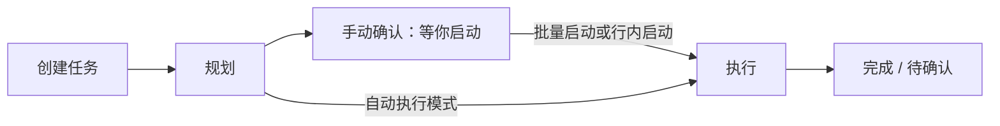

# 任务中心

侧栏 **任务中心**（`#/tasks`）跟进「事」：页顶在两本账之间切换。

> **产品定位**：任务中心 = 用户待办管理 + AI 员工任务协作 + 执行追踪 + 结果交付。  
> **小V** = 全局 AI 小秘书（待办、派发、进度与结果协调），不是某个 AI 员工。  
> 待办事项 ≠ 执行任务；员工间可派发协作，但**不共享**长期记忆。  
> 工作流联动不含「业务参数传递」。完整六大模块、三视角与派发汇报约定见 [任务中心概念](../../explanation/task-center.md)。

| 账本 | 是什么 | 适合 |
|------|--------|------|
| **协作任务** | AI / 员工在干、要进度、要你验收或同意派发的正式账（含员工间 / 上下级派发关系） | Plan、员工值班、工作流跑次、本页「+ 协作任务」 |
| **我的事项** | **用户待办**：个人备忘与关注事项 | 先记「周五交报告」；要对小V说或点派发 → 成协作任务 |

> 别把随手备忘一上来建成协作任务。先记事项，要员工干再派发。也可对小V说「记一条待办」，再到本页核对。

---

## 5 分钟上手

1. 打开 **任务中心**。页顶默认是 **协作任务**。
2. 记备忘：切到 **我的事项** → **+ 新建事项** → 写标题（可加截止、优先级）→ 保存。
3. 要人干：事项卡片上点 **派发** → 选员工。系统会生成关联协作任务。
4. 验收：切回 **协作任务** → 点进详情 → 看总结 / 产物 → **确认完成** 或 **要求修改**（打回须写说明）。
5. 转交卡住时：列表上方 **需要你处理** 会出现「待审批·转交」；进详情点 **同意派发** 或 **驳回**。

也可全程跟小V 说「记一条待办」「有哪些待我确认」，再到本页核对。

---

## 一、何时用哪条路径

| 你想做的事 | 去哪 |
|----------|------|
| 随手记一件事、设截止 | **我的事项** |
| 单会话多步骤、边聊边确认 | [Plan 模式](../chat/plan-mode.md)（聊天底栏；跑起来后会出现在协作任务） |
| 看板看进度、验收、同意派发 | **任务中心 · 协作任务**（本文） |
| 到点跑固定指令 | [自动化](scheduled-tasks.md) |
| 流程已定、只换参数再跑 | [工作流](../configuration/app-center.md)（旧名「应用中心」） |
| 岗位按点上班 | [员工](../configuration/smart-employees.md) |

聊天里的 **Goal（目标 Agent）** 不经过任务中心列表，见 [目标 Agent](../chat/goal-agent.md)。

---

## 二、路由

| 路由 | 页面 |
|------|------|
| `#/tasks` | 任务中心（默认协作任务） |
| `#/tasks?tab=items` | 直接打开「我的事项」 |
| `#/tasks?tab=todo` | 协作任务里只看待办类未完成 |
| `#/tasks?source=role&status=running` 等 | 用查询参数带入来源 / 状态 / 日期筛选 |
| `#/task/:id` | 协作任务详情 |
| `#/workflow/:id` | 全屏工作流 DAG（对话类任务可从详情旁路打开） |

列表会定时静默刷新。筛选会写回 hash，前进后退可还原。

---

## 三、协作任务账本

### 页头

| 控件 | 作用 |
|------|------|
| **协作任务 / 我的事项** | 切换账本 |
| **批量删除** | 进入多选：可批量启动、暂停、删除 |
| **+ 协作任务** | 新建正式协作任务 |

### 状态条（主筛选）

| Tab | 含义 |
|-----|------|
| **全部** | 不按状态筛 |
| **待办** | 未完成待办视图（与 `tab=todo` 对应） |
| **未派发** | `inbox`：随手记下、尚未开跑 / 未派出去 |
| **待处理** | 待执行、规划就绪、待确认、已暂停等「还等一步」的集合 |
| **运行中** | 正在推进（含验证 / 反思 / 等待派发等中间态） |
| **已完成** | 根单已关 |
| **异常** | 失败 / 超时等 |

列表标题会跟着当前 Tab 变，例如「运行中任务」。

### 搜索与筛选

工具栏右侧是搜索框和 **筛选** 按钮。

常驻一行：

| 控件 | 说明 |
|------|------|
| **来源** | 全部 / 对话 / 智能体员工 / 工作流 / 自动化 |
| **显示值班巡检** | 默认隐藏员工心跳产生的「巡检」记录；勾上才显示 |

点开 **筛选** 后还有：

| 控件 | 说明 |
|------|------|
| **工作流** | 按应用 / 工作流 id |
| **智能体** | 按指派智能体或岗位 |
| **时间** | 全部 / 今天 / 近 1 周 / 近 1 月 |
| **每页** | 10 / 20 / 50 |
| **暂停执行中** / **暂停可暂停** | 一键停正在跑的，或停所有可暂停状态 |

当前生效的条件会以芯片显示在列表上方，可 **清除**。

### 列表区块

| 区块 | 内容 |
|------|------|
| **需要你处理** | 目前主要是员工 **转交待审批**（同意派发）。失败任务请用状态条「异常」查看，不堆在这里。默认预览几条，可「查看全部」。 |
| **即将运行的自动化** | 已启用自动化的下次预计运行；可跳到自动化页 |
| **工作事项进度** | 主表格 / 卡片：名称、类型、岗位、智能体、进度、状态、时间、操作 |

行内常见操作：进详情；⋯ 菜单里按状态显隐 **启动 / 暂停 / 取消 / 删除**。未派发（inbox）还有 **派给员工**、**升级为正式任务**、**我已完成**。

父子任务可展开成树；下游提示会写在行上。

### 新建协作任务

点 **+ 协作任务**（或空列表模板卡片）：

| 字段 | 说明 |
|------|------|
| **任务名称** | 必填 |
| **任务描述** | 必填。写清目标、约束、期望产物 |
| **执行模式** | **手动确认**：规划后需你再启动（可用批量启动或行内启动）。**自动执行**：创建后自动规划并跑完 |
| **工作目录** | 可选。AI 在此目录读写；留空用默认项目目录 / 当前工作空间 |

也可在聊天里让主智能体创建等价任务。描述越具体，规划越稳。

### 批量操作

点 **批量删除** 进入多选：

| 底栏按钮 | 说明 |
|----------|------|
| **批量启动** | 对选中的可启动项授权开跑（手动确认模式常用） |
| **批量暂停** | 停选中可暂停项 |
| **批量删除** | 删主任务与子任务，不可恢复；选很多条时会要求确认数量 |
| **取消选择** | 退出多选 |

---

## 四、我的事项账本

切到 **我的事项**（`#/tasks?tab=items`）。这是个人备忘，不是执行引擎。

### 状态

| 状态 | 含义 |
|------|------|
| **待办** | 还没开始或先记着 |
| **进行中** | 你自己正在推进 |
| **处理中** | 已派给别人（如员工），对方在办 |
| **已完成** | 收尾了 |
| **已搁置** | 暂时不做 |

### 新建 / 编辑字段

**+ 新建事项**（或卡片上编辑）：

| 字段 | 说明 |
|------|------|
| **事项** | 标题，必填 |
| **备注** | 背景、验收标准、链接 |
| **处理结论** | 完成后如何收口；建议标完成时填写 |
| **状态** / **优先级** | 待办～搁置；无 / 低 / 中 / 高 / 紧急 |
| **截止时间** | 可选日期 |
| **进度** | 0–100 |
| **标签** | 逗号分隔，便于筛选 |
| **责任意向** | 想交给哪位员工；**意向 ≠ 已派发**，还要点卡片上的 **派发** |

### 卡片操作

| 操作 | 何时 |
|------|------|
| **派发** | 待办 / 进行中：生成关联协作任务并叫醒员工 |
| **催办** | 处理中：再催一下对方 |
| **完成 / 搁置 / 恢复 / 复制 / 删除** | ⋯ 菜单 |
| **打开关联任务** | 已派发后可跳到协作任务详情 |

列表可按状态、优先级、标签筛选；支持批量派发等批处理。

---

## 五、协作任务状态速查

产品统一展示大致八态（底层还会有更细的中间态，列表里常归并显示）：

| 展示 | 含义 | 常见操作 |
|------|------|----------|
| 待办 / 未派发 | 记下了，还没正式开跑 | 派给员工 / 升级 / 自己勾完成 |
| 待处理 | 排队、规划就绪、已暂停等 | 启动 / 暂停 / 删除 |
| 规划中 | 正在出计划 | 暂停 |
| 待执行 | 计划已好，等授权 | 启动 / 批量启动 |
| 执行中 | 子任务在跑 | 暂停；看详情进度 |
| **待确认** | 交工后等人验收（含部分「待闭环」展示） | 详情里 **确认完成** / **要求修改** |
| 已完成 | 根单关闭 | 看结果；可续聊员工任务 |
| 异常 | 失败 / 超时 | **重试失败步骤** / **重新执行** / 看工作流 |
| 已取消 | 手动取消 | 删除或仅回顾 |

**三个易混词：**

| 说法 | 你在干什么 |
|------|------------|
| **待审批 / 同意派发** | 上游已交工，放行叫醒下游。列表「需要你处理」与详情决策区 |
| **待确认** | 认不认这单结果：确认完成或要求修改 |
| **待闭环**（员工概念） | 本岗已交、整单还等下游；任务中心可能仍显示在「待确认 / 待处理」一类里 |

分工细则见 [智能体员工](../configuration/smart-employees.md) 与 [概念说明](../../explanation/smart-employees.md)。

---

## 六、任务详情 `#/task/:id`

### 顶栏

| 控件 | 说明 |
|------|------|
| ← | 回 `#/tasks` |
| **暂停** / **取消** | 按状态显隐 |
| **刷新** | 拉最新 |
| **⋯ 更多** | **续聊该任务**（员工任务）、**打开员工工作项**、**删除任务** |

对话类失败时，决策区可能出现 **查看工作流**。侧栏也可能有「打开工作流」链接到 `#/workflow/:id`。

### 主体

| 区域 | 内容 |
|------|------|
| 顶栏 | 模式徽标（**员工任务** / **工作流**）+ 标题 + 状态；暂停 / 取消 / 更多 |
| 状态横幅 | 失败 / 已取消等终态提示 |
| 进度条 | 执行中显示百分比与当前活动 |
| 主体 | **待你处理**（若有）→ **执行入口卡** → 结果 / 交付物 → 可折叠说明 |
| 员工入口 | 「查看执行过程」→ 右侧栏「执行过程」tab（与工作流同构，单过程，不弹层） |
| 工作流入口 | 「查看工作流详情」→ 客户端左右对切：**左=任务详情整区**，**右=侧栏整区**（标签条+内容，同构对话 RightStage）；再点节点 → 该步输出 tab |
| 信息栏 | 员工信息 / 运行信息（状态、岗位或节点、时间）；低频字段收进「更多」 |

详情页分区（侧栏打开时）：

```
task-detail-page
└── td-split                          ← 与对话 main-body 同级的双区壳
    ├── td-detail-pane                ← 任务详情（顶栏/进度/主栏/信息栏）
    └── td-stage-pane (RightStage)    ← 侧栏（chrome 标签条 + bodies 内容）
```

详情页按来源分成两套体验：**员工**（`role` 岗位 / 值班 / 派发）与 **工作流**（应用跑次、对话协作拆解等）。

### 决策区

| 情境 | 主按钮 |
|------|--------|
| 转交审核（handlers 待批） | **同意派发** · **驳回**（须写原因） |
| 执行已完成、等待确认 | **确认完成** · **要求修改**（须写说明后再确认打回） |
| 执行失败 | **重试失败步骤**（只补跑失败子任务） · **重新执行** · （对话类）**查看工作流** |

任务已取消或失败时，不要再点同意派发。

---

## 七、工作流页 `#/workflow/:id`

全屏看 DAG / 节点对话，与任务详情分工：详情拍板，工作流看节点怎么串。可返回 `#/task/:id`。主对话 Plan 与总控编排见 [Plan 模式](../chat/plan-mode.md)。

---

## 八、暂停、继续与删除

- **暂停**：停主任务继续往下派，并尽量取消活跃子任务。
- **继续 / 启动**：授权后再入队列；上下文与中间产物一般保留。
- **删除**：主任务与子任务一并移除，不可恢复。

人工纠偏：先暂停 → 改目标或约束 → 再启动；或在工作流节点上补充说明。

---

## 九、任务从哪来

| 来源筛选 | 典型入口 |
|----------|----------|
| **对话** | 主对话 Plan「开始执行」、任务中心手动新建、部分 API |
| **智能体员工** | 值班、派发、小V 委派、事项派发到岗 |
| **工作流** | 工作流（旧名「应用中心」）填参运行、工作流调试 / 正式跑次 |
| **自动化** | 定时触发（底层多归在工作流类，筛选里单独可选） |

临时委派用小V；交工验收与同意派发仍回到任务中心。

---

## 十、常见问题

**Q：事项和协作任务怎么选？**  
备忘 → 我的事项。要 AI / 员工执行并验收 → 协作任务，或从事项派发。

**Q：一直停在待处理 / 待执行？**  
看是不是「手动确认」还没启动：用行内启动或批量启动。再查 Gateway 是否在跑、队列是否关闭（`EVOFLOW_TASK_QUEUE_ENABLED=0`）、并发是否已满。

**Q：详情页没有「启动」？**  
多数启动在列表行内或批量工具栏，不在详情顶栏。

**Q：「需要你处理」为什么没有待确认？**  
该区块当前优先展示 **转交待审批**。验收类请用状态条「待处理」或进详情看决策区。

**Q：失败会自动重试吗？**  
队列默认会重试有限次数（见附录），超出后停在异常等你处理。

**Q：删错能恢复吗？**  
不能。重要环境请备份 `~/.evoflow/`。

**Q：员工交工说明在哪？**  
打开该协作任务详情，看概览里的总结 / 产物；完整岗位轨迹仍在员工工作日志。

---

## 附录 A：环境变量（运维）

| 变量 | 默认 | 说明 |
|------|------|------|
| `EVOFLOW_TASK_QUEUE_ENABLED` | `1` | `0` 关闭队列，任务易停在 pending |
| `EVOFLOW_TASK_QUEUE_INTERVAL_SECONDS` | `15` | 队列 tick |
| `EVOFLOW_TASK_QUEUE_MAX_CONCURRENT` | `3` | 同时活跃上限 |
| `EVOFLOW_TASK_QUEUE_RETRY_MAX` | `3` | 失败自动重试次数 |

修改后需重启 Gateway。日常用户不必改。

---

## 附录 B：手动确认 vs 自动执行



---

## 相关阅读

- [任务中心概念](../../explanation/task-center.md) — 小V、用户待办、员工协作派发、三视角与出图原则
- [Plan 模式](../chat/plan-mode.md) — 单会话多步骤
- [工作流](../configuration/app-center.md) — 固定流程填参再跑（旧名「应用中心」）；联动不含业务参数传递
- [智能体员工](../configuration/smart-employees.md) — 值班、交工、同意派发
- [资产中心](../../explanation/asset-center.md) — 员工协作 ≠ 共享长期记忆
- [自动化](scheduled-tasks.md) — 定时触发
- [EvoPanel 指南](../configuration/evopanel-guide.md) — 侧栏地图
