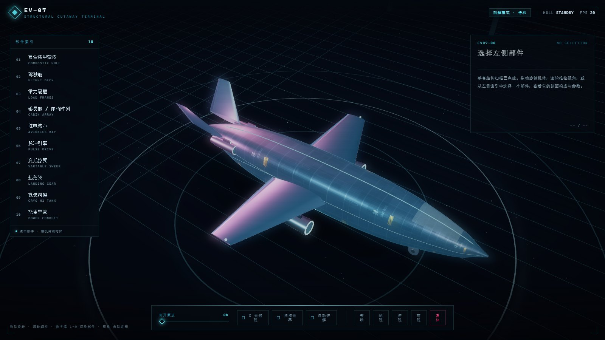
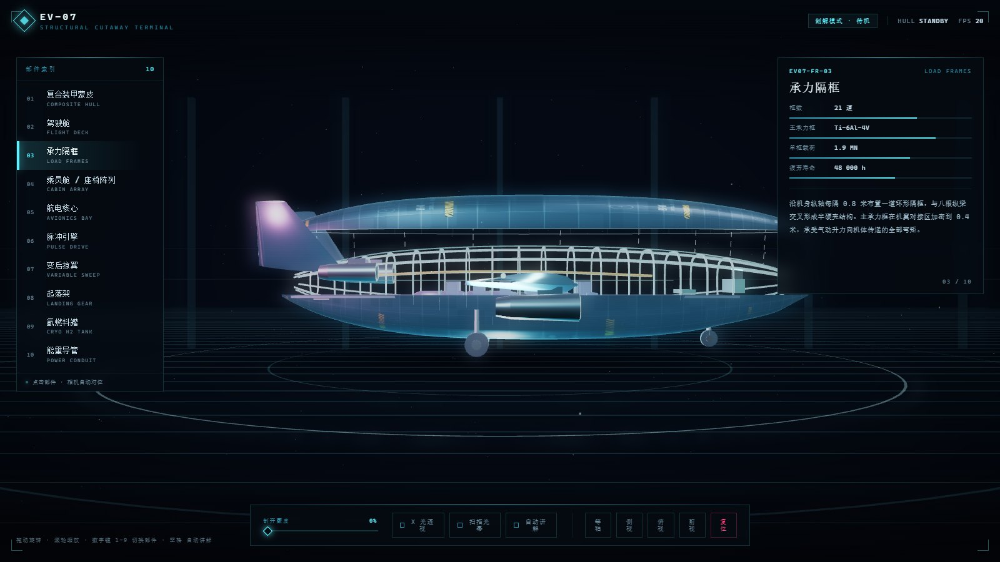

# EV-07 · 结构剖解终端

赛博朋克风格的飞行器构造讲解页。整机由代码程序化生成——没有外部模型文件，没有贴图资源，`index.html` 双击就能跑。



## 打开

直接双击 `index.html`。不需要服务器、不需要安装依赖，`vendor/three.min.js` 已内置（离线可用）。

## 交互

| 操作 | 效果 |
|------|------|
| 拖动 | 旋转视角（带阻尼，松手后缓慢自转） |
| 滚轮 | 推拉远近 |
| 拖动「剖开蒙皮」 | 上半机身抬离，露出内部承力结构 |
| 点击左侧部件 / 数字键 `1`-`9` `0` | 相机飞向该部件，参数面板展开 |
| `X 光透视` | 蒙皮变半透明，不移动也能看内部 |
| `扫描光幕` | 一道光幕沿机身扫过 |
| `自动讲解` / `空格` | 依次巡讲全部 10 个部件 |
| 等轴 / 侧视 / 俯视 / 前视 / 复位 | 预设机位 |

## 十个可讲解的部件

蒙皮 · 驾驶舱 · 承力隔框 · 乘员舱 · 航电核心 · 脉冲引擎 · 变后掠翼 · 起落架 · 氢燃料罐 · 能量导管

每个部件带编号、四项参数（含可视化数值条）和一段说明。



## 怎么实现的

**机体是算出来的。** 机身用 15 组控制点描述截面（半宽、上半高、下半高、超椭圆指数），Catmull-Rom 插值到 96 段，每段一圈 28 个点，loft 成蒙皮。机翼走 NACA 四位数翼型公式，沿展向放样 22 段，厚度和弦长线性收敛。

**剖开是真的分成两半。** 蒙皮按 θ 从 `0→π` 和 `π→2π` 分别生成上、下两个半壳，共用接缝顶点。上半壳挂在一个 Group 上，抬升时内部结构才设 `visible`，并用虚线把机身脊线和抬起的盖子连起来——工程分解图的那套语言。

**金属靠环境贴图，不靠平行光。** 用 canvas 画一张带机库灯带的等距柱状贴图，过 `PMREMGenerator` 变成环境反射。金属度为 0.9 的材质没有环境贴图就是死黑一片，这一步是立体感的分水岭。

**边缘光单独一层。** 克隆机身几何，套一个 Fresnel 着色器（`1 - dot(N, V)` 取幂），加色混合叠在表面，只在掠射角亮起来，勾出轮廓。

**泛光不写后期管线。** 主画布每帧缩到 1/3 画进另一个 canvas，那层 canvas 用 CSS `filter: blur() saturate()` + `mix-blend-mode: screen` 叠回去。省掉 EffectComposer，效果够用。

## 踩过的坑

- **上下两条半壳的三角形绕序要各自正确**，否则正面被剔除，机身看起来像玻璃罩，能看穿。
- **镜像侧的翼面要翻转索引**，光靠 `z = -z` 镜像顶点，法线会朝内。
- **Canvas 贴图必须标 `sRGBEncoding`**。默认按线性解读，深色贴图会被提亮成青白色，整机像塑料。
- **点光源放在机舱里会过曝**。座椅本来是深蓝，被 3.4 强度的点光直打后全白，得把灯移高、强度砍到 1.15。
- **剖开的盖子别翻向相机**。一开始做成绕右舷铰链翻开，相机在右侧时正好被它挡住，改回平移 + 引线才对。

## 性能

约 2.1 万三角形、77 次 draw call。桌面浏览器独显下 60fps 无压力；软件光栅（SwiftShader）1600×900 约 22fps。

## 文件

```
index.html          入口
css/style.css       界面
js/data.js          15 组机身控制点 + 10 个部件讲解文案
js/ship.js          几何生成（机身 / 翼面 / 内部结构 / 贴花）
js/scene.js         场景、相机、光照、剖开动画、分解引线
js/ui.js            部件索引、参数面板、自动讲解
js/main.js          装配 + 开场运镜
vendor/three.min.js three.js r149 (UMD)
shots/final.js      无头浏览器验收脚本
```

想改成别的机器？改 `data.js` 的 `PROFILE` 就是另一副机身轮廓，改 `PARTS` 就是另一套讲解词。
