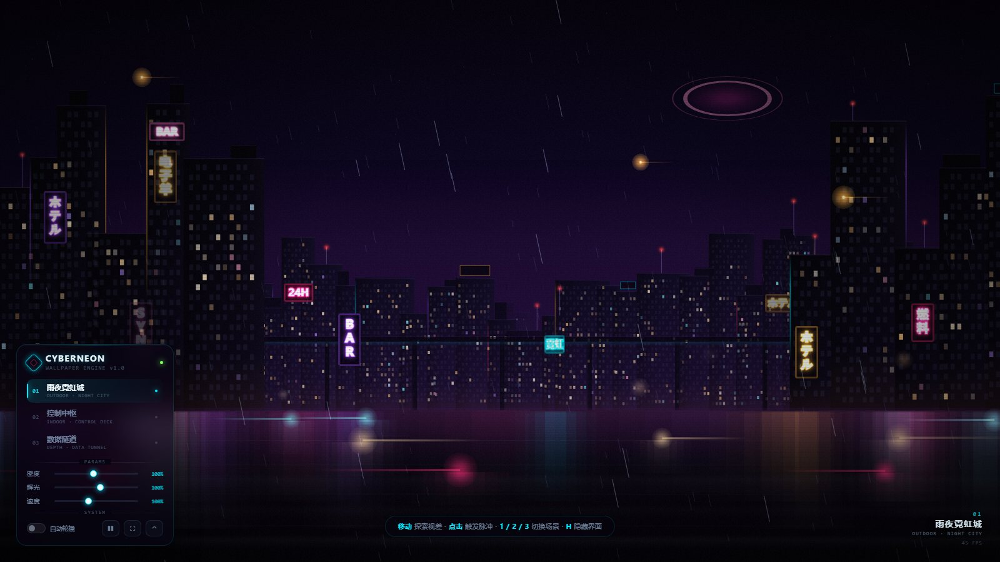
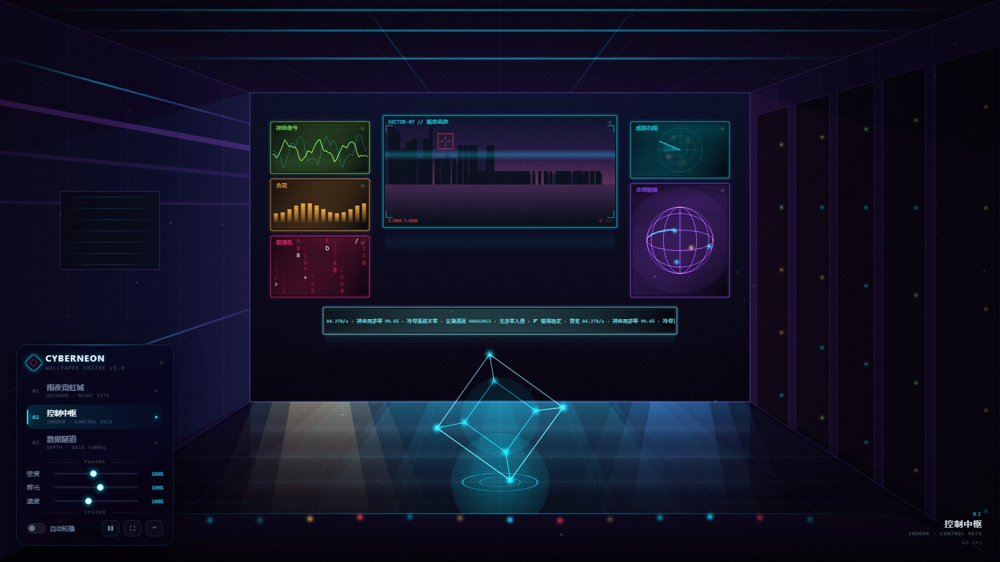
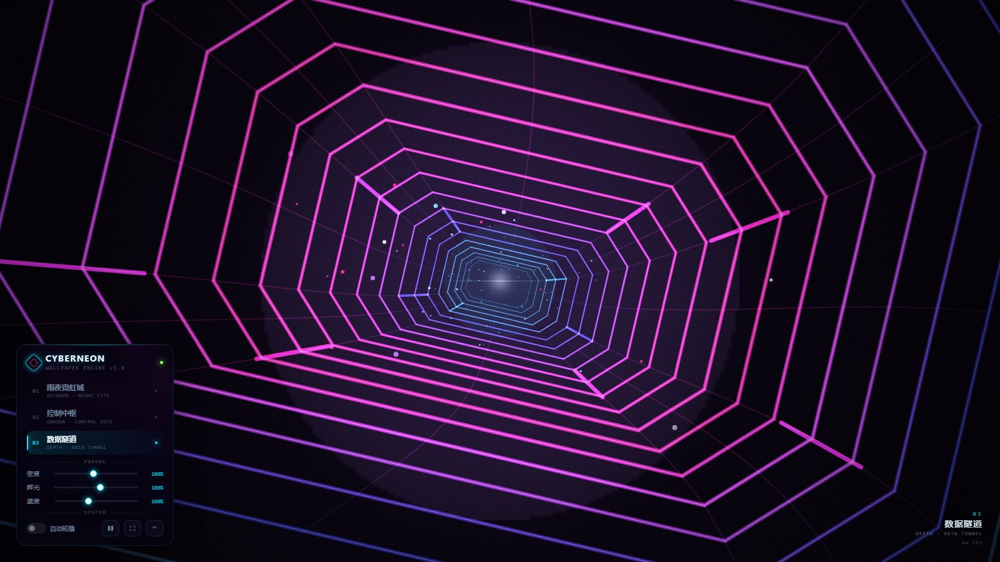

# CyberNeon · 赛博朋克动态壁纸

纯 Canvas 2D 实时渲染的交互式桌面壁纸。零依赖、零构建，双击 `index.html` 就能跑。

> 这是技能 `dynamic-wallpaper` 内的可直接运行案例；方法论、渲染管线与踩坑清单见上级目录 `../SKILL.md`。

## 三个场景

用 `1` `2` `3` 或左下角面板切换，切换时有黑场过渡。

### 01 · 雨夜霓虹城（室外）



分层视差天际线（远/中/近三层独立的预渲染层）、成排的窗灯、霓虹招牌、高架单轨与驶过的列车、地面车流、盘旋的飞行器、斜向雨幕，以及湿地上的霓虹倒影。天空有一颗环状天体。

### 02 · 控制中枢（室内）



一点透视的控制室。后墙六块屏幕各自跑不同的实时内容：城市监控、神经波形、负载柱状图、滚动代码、威胁雷达、全息地球。桌面中央有一个自转的全息立方体，屏幕光会投在地板上形成竖直光柱。

### 03 · 数据隧道（纵深）



切角矩形截面的透视管道。环按对数分布排列（这是透视的正确解法，线性分布会挤成一堆同心圆），颜色沿深度从青渐变到紫红，管壁上有向观众滑动的数据流光段。

## 交互

| 操作 | 效果 |
| --- | --- |
| 移动鼠标 | 多层视差 + 各场景的镜头微移 |
| 点击 / 触摸 | 冲击波环 + 光晕爆发（隧道场景会额外加速并爆出火花） |
| `1` `2` `3` | 切换场景 |
| `N` | 下一个场景 |
| `空格` | 暂停 / 继续 |
| `F` | 全屏 |
| `H` | 隐藏 / 显示界面 |

鼠标静止 2.4 秒后控制面板会自动淡出，移动即恢复。隐藏界面后，把鼠标移到屏幕左下角可以重新唤出面板。

面板里的三个滑块分别控制**密度**（雨量、粒子、尘埃）、**辉光**、**运动速度**；"自动轮播"开启后每 45 秒换一个场景。设置会存进 `localStorage`。

## 设为桌面壁纸

**Windows — Lively Wallpaper（免费，推荐）**
1. 打开 Lively → `Add Wallpaper` → 选中本目录的 `index.html`
2. 在壁纸设置里关掉鼠标交互穿透（如需保留交互），或调整输入模式

**Wallpaper Engine**
1. `Create Wallpaper` → 选 `Web` 类型
2. 指向本目录，入口文件填 `index.html`

**浏览器**
直接双击 `index.html`，按 `F11` 全屏即可。不需要起服务器。

**macOS**
用 Plash 之类的工具加载本地网页文件。

## 性能

- 静态部分（天空、天际线、房间）预渲染到离屏 canvas，每帧只做一次 `drawImage`
- 所有发光用预渲染的高斯径向贴图叠加，不用 `shadowBlur` / `filter: blur`
- 泛光（bloom）用两级降采样替代真实模糊，可在面板里关掉
- 帧率低于 40 会**自动降级**：关掉泛光、减少粒子
- 按屏幕面积限制像素密度（4K 屏降到 `dpr = 1`），动态壁纸优先保帧率

1080p 下正常独显/核显环境可以稳定 60fps。

## 结构

```
index.html
css/style.css          界面样式
js/main.js             入口
js/core/utils.js       数学 / 颜色 / 发光贴图缓存
js/core/engine.js      主循环 / DPI 适配 / 输入 / 后处理 / 自适应降级
js/scenes/outdoor.js   场景 01
js/scenes/indoor.js    场景 02
js/scenes/tunnel.js    场景 03
```

新增场景：写一个带 `resize / update / draw` 的类，在 `main.js` 里 `engine.register('名字', factory)`，再往 `js/ui/panel.js` 的 `SCENE_META` 加一条即可。

## 兼容性

Chrome / Edge / WebView2 95+。用到 `backdrop-filter`（面板毛玻璃）和 Canvas 2D 的 `lighter` 合成，都是现代浏览器标配。没有外部字体和图片依赖，断网也能跑。
